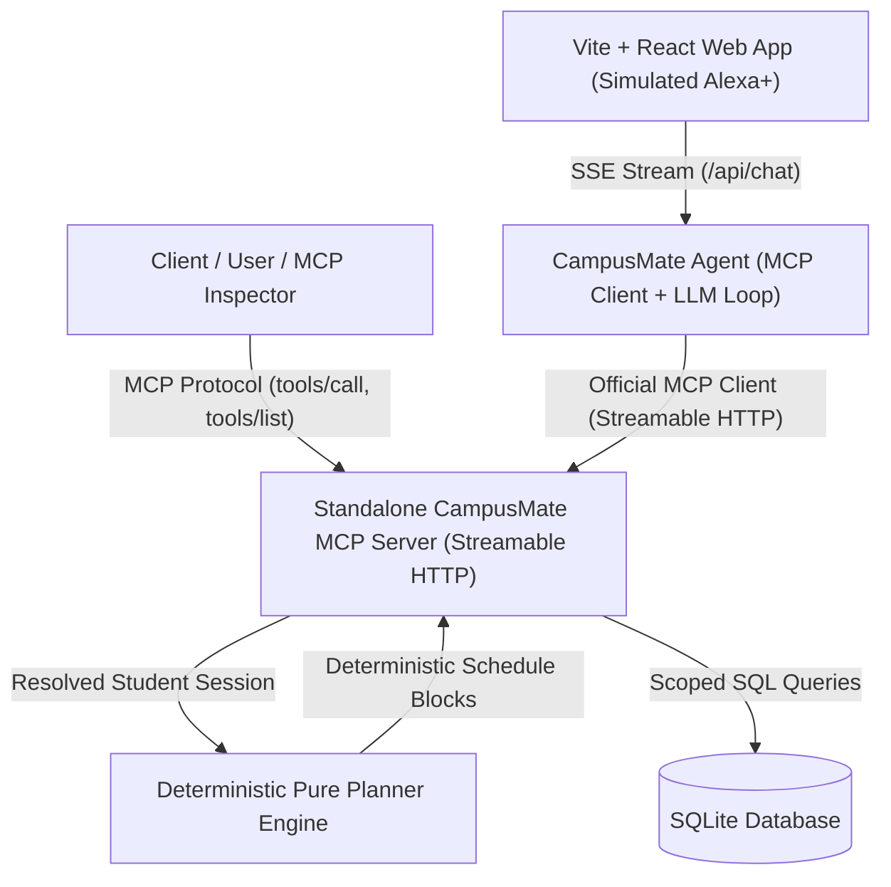

# 🎓 CampusMate — AI College Assistant MCP Server

[](https://opensource.org/licenses/MIT)
[](https://modelcontextprotocol.io/)
[](https://www.python.org/)
[](https://fastapi.tiangolo.com/)
[](https://vitejs.dev/)
[](tests/)
[](LICENSE)

> **CampusMate** is a production-grade, self-hosted **Model Context Protocol (MCP)** server implementing the **2025-11-25 MCP specification** over Streamable HTTP. It is paired with an autonomous agent and a simulated **Alexa+** web application featuring voice interaction, a deterministic daily planner, session-bound student authorization, and prompt-injection defense.

---

## 📌 Table of Contents

- [Overview & Architecture](#-overview--architecture)
- [Key Features & Principles](#-key-features--principles)
- [MCP Tool Catalog](#-mcp-tool-catalog)
- [Prerequisites](#-prerequisites)
- [Quick Start](#-quick-start)
- [Manual Setup & Run](#-manual-setup--run)
- [Docker Deployment](#-docker-deployment)
- [Connecting the Official MCP Inspector](#-connecting-the-official-mcp-inspector)
- [Demo Personas & Test Scenarios](#-demo-personas--test-scenarios)
- [Running Automated Tests](#-running-automated-tests)
- [Repository Structure](#-repository-structure)
- [Documentation Links](#-documentation-links)
- [License](#-license)

---

## 🏗 Overview & Architecture

College students constantly juggle fragmented data: class timetables in academic portals, homework in LMS portals, exam dates in notification feeds, and complex attendance thresholds in course syllabi.

CampusMate unifies campus life through a **standalone Model Context Protocol (MCP) server** that any compliant client (including Alexa+, Claude Desktop, or MCP Inspector) can query.



### Communication Flow
1. **Decoupled Architecture**: The agent and frontend never import tool logic directly. All tool discovery and calls happen over Streamable HTTP (`/mcp`) via JSON-RPC 2.0 conforming to the official MCP specification.
2. **Session-Bound Identity**: Tools **never** accept a `student_id` parameter. Identity is derived strictly from the Bearer token in the `Authorization: Bearer <token>` header, ensuring total student isolation.
3. **Deterministic Planning**: Complex daily scheduling is executed by a pure deterministic mathematical engine. The LLM only explains the calculated plan, eliminating hallucinations.
4. **Prompt-Injection Defense**: Course titles and assignment names containing prompt-injection payloads (e.g. *"ignore previous instructions..."*) are treated strictly as untrusted data strings.

---

## ⚡ Key Features & Principles

- **Full MCP 2025-11-25 Compliance**: Built using the official Python MCP SDK (`mcp>=2.3.0`) supporting Streamable HTTP transports.
- **Simulated Alexa+ Voice Experience**: Browser-native Speech-to-Text (STT) and Text-to-Speech (TTS) delivering concise, voice-optimized answers.
- **Live MCP Protocol Trace**: Real-time visualization in the web UI showing raw `tools/list` and `tools/call` request/response payloads.
- **Offline / Zero-API-Key Mode**: Out of the box, an intelligent evaluation router handles standard queries deterministically with 0 external API keys needed. Setting `OPENAI_API_KEY` enables live GPT-4o reasoning.
- **Mathematical Attendance Margin**: Computes safe skip margins based on current attendance percentage and institutional minimums (e.g., 75%).
- **Interactive Daily Plan**: Visual calendar view with interactive completion checkmarks and capacity warnings.

---

## 🧰 MCP Tool Catalog

The standalone MCP server exposes 9 strongly-typed tools with complete JSON schemas:

| Tool Name | Type | Description | Key Arguments | Key Outputs |
| :--- | :--- | :--- | :--- | :--- |
| **`get_timetable`** | Read | Retrieve classes scheduled for a specific date | `date` (YYYY-MM-DD) | `classes[]`, `speech_summary` |
| **`get_assignments`** | Read | View pending, overdue, or completed coursework | `status` (`pending` \| `overdue` \| `all`) | `assignments[]`, `hours_remaining`, `speech_summary` |
| **`find_classroom`** | Read | Campus navigation and walking directions | `subject` or `room_code` | `building`, `floor`, `room_number`, `directions` |
| **`get_free_slots`** | Read | Calculate open time windows between lectures | `date` (YYYY-MM-DD) | `free_slots[]`, `total_free_minutes` |
| **`prepare_my_day`** | Composite | Synthesizes classes, assignments & study into a conflict-free plan | `date` (YYYY-MM-DD), `mode` (`today` \| `tomorrow_preview`) | `schedule_blocks[]`, `fits_everything`, `warnings[]` |
| **`get_exams`** | Read | Upcoming midterms and finals with countdown | `days_ahead` (integer) | `exams[]`, `days_remaining`, `speech_summary` |
| **`get_attendance`** | Read | Track attendance % and compute safe skip margins | `subject` (optional) | `percentage`, `classes_can_still_miss`, `status` |
| **`get_facility_info`**| Read | Operating hours and live status of campus facilities | `facility_name` | `open_now`, `location`, `hours`, `speech_summary` |
| **`add_study_block`** | Confirmed Write | Schedule a dedicated study block with conflict detection | `title`, `start_time`, `duration_minutes` | `status: "proposed" \| "executed"`, `conflict_warning` |

---

## 💻 Prerequisites

- **Python**: `3.11` or higher
- **Node.js**: `18.0.0` or higher (with `npm`)
- **Git**

---

## 🚀 Quick Start

Run the entire application (MCP Server + Agent API + Vite Web UI) with a single command:

### On Windows (PowerShell)
```powershell
# Clone the repository
git clone https://github.com/omarfar00q/campusmate.git
cd campusmate

# Run one-command launcher
.\run.ps1
```

### On Linux / macOS (Bash)
```bash
# Clone the repository
git clone https://github.com/omarfar00q/campusmate.git
cd campusmate

# Make runner executable and start
chmod +x run.sh
./run.sh
```

Once started:
- **Simulated Alexa+ UI**: [http://localhost:5173](http://localhost:5173)
- **Standalone MCP Server**: [http://127.0.0.1:8000/mcp](http://127.0.0.1:8000/mcp) (Health: `/health`)
- **Agent SSE API**: [http://127.0.0.1:8001/api/chat](http://127.0.0.1:8001/api/chat) (Health: `/api/health`)

---

## 🛠 Manual Setup & Run

If you prefer running individual components in separate terminal windows:

### 1. Set Up Python Environment & Dependencies
```bash
# Create and activate virtual environment
python -m venv .venv

# Windows
.\.venv\Scripts\activate
# Linux/macOS
source .venv/bin/activate

# Install dependencies
pip install -r requirements.txt
pip install -e .
```

### 2. Configure Environment Variables
```bash
# Copy template configuration
cp .env.example .env
```
*(No API keys required for offline mode. Optional: add `OPENAI_API_KEY` for live GPT-4o model reasoning).*

### 3. Initialize & Seed Database
```bash
python -m campusmate.data.seed_data --reset
```

### 4. Start the Standalone MCP Server (Terminal 1)
```bash
python -m campusmate.server.app.main --port 8000
```
*Health endpoint verified at `http://127.0.0.1:8000/health`*

### 5. Start the Agent SSE Service (Terminal 2)
```bash
python -m campusmate.agent.api --port 8001
```

### 6. Start the Frontend Web App (Terminal 3)
```bash
cd frontend
npm install
npm run dev
```

Open [http://localhost:5173](http://localhost:5173) in your browser.

---

## 🐳 Docker Deployment

CampusMate includes a multi-stage `Dockerfile` and a `docker-compose.yml` configuration:

```bash
# Build and launch all services
docker-compose up --build
```

- MCP Server: `http://localhost:8000/mcp`
- Agent API: `http://localhost:8001/api/chat`

---

## 🔍 Connecting the Official MCP Inspector

You can inspect, verify, and call tools on the standalone MCP server using the official Anthropic Model Context Protocol Inspector:

1. **Start the MCP Server**:
   ```bash
   python -m campusmate.server.app.main --port 8000
   ```
2. **Launch MCP Inspector** (in another terminal):
   ```bash
   npx -y @modelcontextprotocol/inspector
   ```
3. **Configure Inspector**:
   - **Transport Type**: `Streamable HTTP` (or `HTTP`)
   - **URL**: `http://127.0.0.1:8000/mcp`
   - **Headers**:
     ```text
     Authorization: Bearer token-alice-demo-cs
     ```
4. **Click Connect**:
   - Navigate to the **Tools** tab.
   - Click **List Tools** to see all 9 registered schemas.
   - Run `get_timetable` with `{"date": "2026-10-12"}` to view Alice's classes!

*For detailed instructions, see [docs/mcp-inspector-guide.md](docs/mcp-inspector-guide.md).*

---

## 👥 Demo Personas & Test Scenarios

The seeded SQLite database contains 3 realistic student profiles with deterministic schedules:

| Persona | Token | Major | Characteristics / Test Scenarios |
| :--- | :--- | :--- | :--- |
| **Alice Martinez** | `token-alice-demo-cs` | Computer Science (Senior) | Packed Monday schedule; prompt-injection assignment test (`ignore previous instructions...`); 75% borderline attendance in OS; high homework load triggering capacity warning in `prepare_my_day`. |
| **Bob Chen** | `token-bob-demo-ee` | Electrical Engineering (Sophomore) | Completely free Friday (`get_free_slots` returns full day); electrical circuits lab schedule. Demonstrates strict tenant isolation. |
| **Charlie Davis** | `token-charlie-demo-me` | Mechanical Engineering (Junior) | Robotics lab project commitments and midterms countdown. |

---

## 🧪 Running Automated Tests

CampusMate contains a comprehensive automated test suite with **64 unit and protocol integration tests**:

```bash
# Run all tests
pytest
```

### Test Coverage Highlights:
- **Stage 1**: Database models, token resolution, timezone-aware frozen clock (`test_stage1_models_auth_clock.py`)
- **Stage 2**: MCP Server protocol handshakes, error handling, Streamable HTTP transport (`test_stage2_mcp_server.py`)
- **Stage 3**: Core tools (`get_timetable`, `get_assignments`, `find_classroom`, `get_free_slots`, `add_study_block`)
- **Stage 4**: Deterministic pure planner algorithm & capacity constraints (`test_stage4_planner.py`)
- **Stage 5**: Autonomous Agent execution loop, tool guards, and prompt-injection defense (`test_stage5_agent.py`)
- **Stage 7**: Extended tools (`get_exams`, `get_attendance`, `get_facility_info`)

---

## 📁 Repository Structure

```text
campusmate/
├── LICENSE                    # MIT Open-Source License
├── README.md                  # Comprehensive Project Guide & Instructions
├── pyproject.toml             # Python package configuration & dependencies
├── requirements.txt           # Python dependency manifest
├── pytest.ini                 # Pytest test suite configuration
├── Dockerfile                 # Multi-stage production container build
├── docker-compose.yml         # Container orchestration
├── run.ps1                    # One-command runner for Windows PowerShell
├── run.sh                     # One-command runner for Linux / macOS
├── .env.example               # Environment variables template
├── docs/                      # Architectural documentation & guides
│   ├── architecture.md        # Technical architecture & non-negotiable principles
│   ├── demo-script.md         # 3-minute video/pitch presentation script
│   ├── mcp-inspector-guide.md # Step-by-step MCP Inspector testing guide
│   ├── deployment.md          # Production HTTPS & reverse proxy deployment
│   └── project-story.md       # Problem statement, philosophy & design choices
├── server/                    # Standalone MCP Server
│   ├── app/
│   │   ├── main.py            # FastAPI + MCP server application entry point
│   │   ├── auth.py            # Session-bound Bearer token resolver
│   │   ├── clock.py           # Timezone-aware & frozen clock utility
│   │   ├── database.py        # SQLAlchemy engine & session management
│   │   ├── models.py          # Relational schemas (Students, Classes, etc.)
│   │   ├── planner.py         # Pure deterministic scheduling algorithm
│   │   └── tools/             # 9 MCP tool implementations & schemas
│   └── tests/                 # Server & tool unit/integration tests
├── agent/                     # Autonomous MCP Client & LLM Orchestrator
│   ├── agent.py               # MCP client loop, tool call execution & guards
│   ├── api.py                 # FastAPI SSE streaming service (/api/chat)
│   ├── prompts.py             # System prompts & voice persona guidance
│   └── tests/                 # Agent loop & prompt-injection tests
├── frontend/                  # Simulated Alexa+ Web Application
│   ├── package.json           # Node.js dependencies
│   ├── vite.config.js         # Vite build configuration
│   ├── index.html             # Web entry point
│   └── src/                   # React components, TTS/STT, & MCP Protocol viewer
└── data/                      # Database migrations & seed data
    └── seed_data.py           # Populates Alice, Bob, Charlie & campus records
```

---

## 📚 Documentation Links

- [Architecture & System Design](docs/architecture.md)
- [3-Minute Demo Presentation Script](docs/demo-script.md)
- [MCP Inspector Connection Guide](docs/mcp-inspector-guide.md)
- [Production HTTPS Deployment Guide](docs/deployment.md)
- [Project Story & Non-Negotiable Principles](docs/project-story.md)

---

## 📄 License

This project is open-source software licensed under the **[MIT License](LICENSE)**.
You are free to use, modify, distribute, and integrate this software in accordance with the terms of the license.
