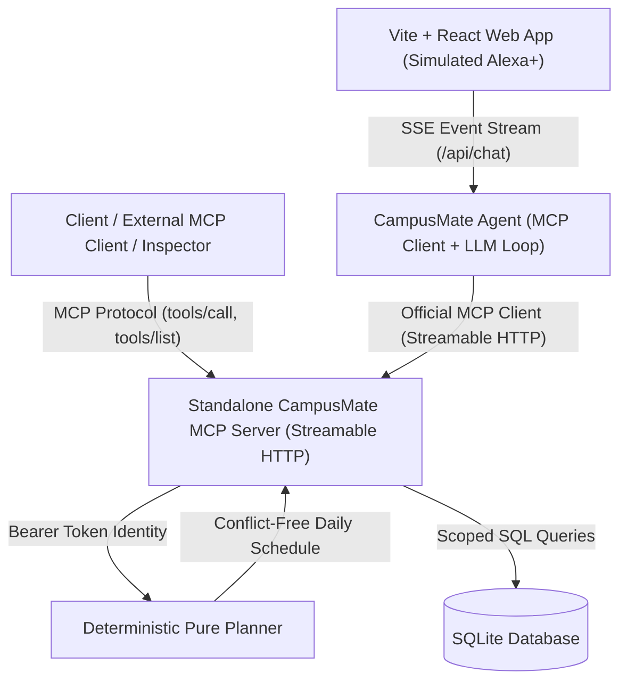

# CampusMate — AI College Assistant

**CampusMate** is an AI college voice assistant built for the **Alexa+** hackathon track:
> *"Build a working Agent Skill or a self-hosted MCP server implementing MCP spec version 2025-11-25 or later. Optionally simulate the Alexa+ experience in a web app using your own agentic tools."*

Our deliverable consists of:
1. **Self-Hosted MCP Server (Primary Submission)**: A standalone, fully compliant Model Context Protocol server exposing deterministic tools over Streamable HTTP (MCP Spec 2025-11-25 / Python SDK `mcp==2.3.0`).
2. **Alexa+ Simulated Web Assistant (Secondary)**: A modern web interface simulating the voice-assistant experience, with real-time protocol traces, student authorization switcher, and interactive daily schedule plans.

---

## Architecture Overview



---

## Non-Negotiable Principles Adherence

* **Principle 1 (Standalone Product)**: The MCP server runs independently on port `8000` and can be inspected by any compliant MCP client (e.g. `npx @modelcontextprotocol/inspector`).
* **Principle 2 (Protocol Decoupling)**: The agent connects to the server strictly through the official MCP protocol over Streamable HTTP. It never imports tool functions directly.
* **Principle 3 (Current Spec & Pinned SDK)**: Built on **MCP Specification revision `2025-11-25`** using the official SDK **`mcp==2.3.0`**.
* **Principle 4 (Session-Bound Identity)**: No tool accepts a `student_id` or group argument. Identity is resolved solely from the authenticated session's Bearer token.
* **Principle 5 (No Arbitrary Execution)**: The LLM never writes SQL or executes shell commands. It selects exclusively from the fixed, discoverable tool set.
* **Principle 6 (No Hallucinations)**: The LLM never invents timetable entries, rooms, deadlines, or times.
* **Principle 7 (Deterministic Planner)**: Scheduling is 100% deterministic pure code with unit tests. The LLM only explains the plan in natural language.
* **Principle 8 (Secrets Hygiene)**: API keys live in environment variables. The frontend never sees LLM keys or database connections.
* **Principle 9 (Graceful Tool Errors)**: Errors return readable tool results; the server never crashes on bad input.
* **Principle 10 (Prompt Injection Defense)**: Tool results are treated strictly as data payloads, preventing adversarial injection in coursework titles.

---

## Implemented MCP Tools

| Tool | Type | Description |
| :--- | :--- | :--- |
| **`get_timetable`** | Read-Only | Class schedules with start/end times, room, building, floor, and spoken summary. |
| **`get_assignments`** | Read-Only | Assignments with status filters, hours remaining, and overdue tracking. |
| **`find_classroom`** | Read-Only | Course location lookup with step-by-step walking directions. |
| **`get_free_slots`** | Read-Only | Interval calculation of open gaps between classes. |
| **`prepare_my_day`** | Read-Only | **Standout Feature**: Synthesizes classes, assignments, and exams into an optimized daily plan with lunch buffers and capacity warnings. |
| **`get_exams`** | Read-Only | Exam schedules with countdown days remaining. |
| **`get_attendance`** | Read-Only | Exact attendance percentages and mathematical skip margins (`classes_can_still_miss`). |
| **`get_facility_info`** | Read-Only | Operating hours and live open/closed status for Library, Canteen, and AI Lab. |
| **`add_study_block`** | Confirmed Write | Two-phase confirmed write tool with class conflict detection. |

---

## Quick Start (One Command Run)

### 1. Requirements
* Python 3.11+
* Node.js 18+

### 2. Setup Environment
```bash
# Clone and enter directory
cd campusmate

# Create and activate virtual environment
python -m venv .venv
# On Windows:
.venv\Scripts\activate
# On Linux/macOS:
source .venv/bin/activate

# Install server dependencies
pip install -r server/requirements.txt
pip install openai

# Install frontend dependencies
cd frontend && npm install && cd ..
```

### 3. Run Everything with One Command
* **On Windows (PowerShell)**:
  ```powershell
  .\run.ps1
  ```
* **On Linux / macOS (Bash)**:
  ```bash
  chmod +x run.sh && ./run.sh
  ```
* **Via Docker Compose**:
  ```bash
  docker compose up --build
  ```

### 4. Endpoints
* **Frontend Web App**: `http://127.0.0.1:5173`
* **MCP Server**: `http://127.0.0.1:8000/mcp` (Health: `http://127.0.0.1:8000/health`)
* **Agent SSE API**: `http://127.0.0.1:8001/api/chat` (Health: `http://127.0.0.1:8001/api/health`)

---

## Connecting with MCP Inspector

To inspect the standalone MCP server:
```bash
npx -y @modelcontextprotocol/inspector
```
1. Select **Streamable HTTP**.
2. Enter URL: `http://127.0.0.1:8000/mcp`.
3. Add Custom Header: `Authorization: Bearer token-alice-demo-cs`.
4. Click **Connect** and explore all 8 tools with full schemas!

---

## Test Suite Execution

Run all 64 automated tests:
```powershell
& ".venv\Scripts\pytest.exe" -v
```
Output:
```text
server/tests/test_stage1_models_auth_clock.py   (9 passed)
server/tests/test_stage2_mcp_server.py          (6 passed)
server/tests/test_stage3_core_tools.py          (11 passed)
server/tests/test_stage4_planner.py             (10 passed)
server/tests/test_stage7_tools.py               (11 passed)
agent/tests/test_stage5_agent.py                (17 passed)

============================= 64 passed in 14.37s =============================
```

---

## Definition of Done Verification

- [x] **Server works standalone with MCP Inspector and the official client SDK**; tools discoverable with schemas.
- [x] **All 8 tools tested**; `prepare_my_day` is deterministic and honest when time is insufficient.
- [x] **Two students see different data**; cross-access attempts fail (verified in tests).
- [x] **Agent calls tools through the protocol**; UI shows the live real-time trace.
- [x] **One-command local run** (`run.ps1`, `run.sh`, `docker-compose.yml`), seed data resets cleanly (`--reset`).
- [x] **Documentation complete** ([docs/architecture.md](docs/architecture.md), [docs/demo-script.md](docs/demo-script.md), [docs/deployment.md](docs/deployment.md), and [docs/mcp-inspector-guide.md](docs/mcp-inspector-guide.md)).
