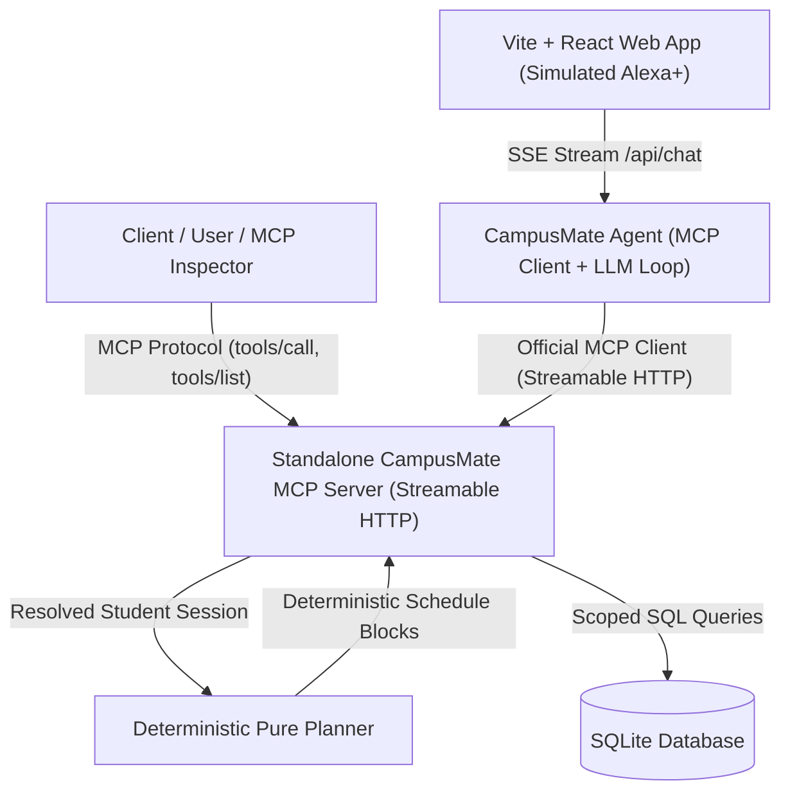

# CampusMate — Architecture & System Design

CampusMate is an AI college assistant built for the **Alexa+** hackathon track:
> *"Build a working Agent Skill or a self-hosted MCP server implementing MCP spec version 2025-11-25 or later. Optionally simulate the Alexa+ experience in a web app using your own agentic tools."*

---

## 1. High-Level Architecture

---

## 2. Non-Negotiable Architectural Principles

1. **Standalone MCP Server as the Primary Product**: The server runs standalone and is usable by any compliant MCP client (including the official MCP Inspector) without the frontend.
2. **Protocol Decoupling**: The agent never imports tool functions directly. Communication occurs exclusively over the Model Context Protocol (Streamable HTTP transport, JSON-RPC 2.0).
3. **Session-Bound Identity (Principle 4)**:
   - Identity is derived strictly from the Bearer token (`Authorization: Bearer <token>`).
   - No tool accepts a `student_id` or group argument.
   - All database queries and planning actions are pre-filtered to the resolved student.
4. **Deterministic Planner (Principle 7)**:
   - Scheduling is 100% deterministic code with pure functions.
   - The LLM only explains the plan in natural language.
5. **Prompt Injection Immunity (Principle 10)**:
   - Tool outputs are treated strictly as data payloads, never executed as instructions.
   - Malicious strings in assignment titles (e.g. *"ignore previous instructions..."*) are treated as benign text strings.
6. **Zero Secrets in Frontend (Principle 8)**:
   - The frontend never has access to the database or LLM API keys.

---

## 3. Tool Specifications & Schemas

| Tool Name | Type | Description | Key Outputs |
| :--- | :--- | :--- | :--- |
| `get_timetable` | Read-only | Class schedule for date | `classes`, `speech_summary` |
| `get_assignments` | Read-only | Assignments filtered by status | `hours_remaining`, `is_overdue`, `speech_summary` |
| `find_classroom` | Read-only | Classroom location & walking directions | `building`, `floor`, `room_number`, `directions` |
| `get_free_slots` | Read-only | Available study intervals between classes | `free_slots`, `total_free_minutes` |
| `prepare_my_day` | Read-only | Composite personalized day plan | `schedule_blocks`, `fits_everything`, `warnings` |
| `get_exams` | Read-only | Scheduled exams with countdown | `days_remaining`, `room`, `speech_summary` |
| `get_attendance` | Read-only | Attendance percentage & safe skip margin | `classes_can_still_miss`, `status`, `speech_summary` |
| `get_facility_info`| Read-only | Campus facility hours & open status | `open_now`, `location`, `hours` |
| `add_study_block` | Confirmed Write | Schedule custom study session | `status: "proposed" \| "executed"`, conflict check |

---

## 4. What is Simulated vs. Real Alexa+ Integration

| Capability | In This Implementation (Hackathon Prototype) | Real Alexa+ Production Integration |
| :--- | :--- | :--- |
| **Voice Persona** | Simulated in web app via Web Speech API (TTS & STT) | Echo device audio streaming via Alexa Voice Service (AVS) |
| **Tool Execution** | Agent calls self-hosted MCP server over Streamable HTTP | Alexa+ Agent invokes self-hosted MCP server via Amazon Skill MCP Bridge |
| **Session Auth** | Demo Bearer tokens mapped to fictional student records | Amazon Account Linking with OAuth 2.1 tokens |
| **Streaming** | Server-Sent Events (SSE) to browser | Bidirectional gRPC / WebSocket audio streaming |
| **MCP Server** | **Real, compliant MCP server (Spec 2025-11-25)** | **Same identical MCP server deployed over HTTPS** |
